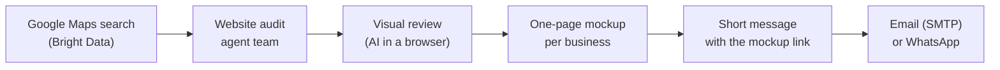

# Prospect Pilot

**Find local businesses that are losing customers because of their website — build them a better one before you even reach out — and send the link.**

Most small businesses (bakers, plumbers, hair salons…) are found on Google Maps. Many of them have no
website, only an Instagram page, or a site from 2008 that says "Not secure" in Chrome. Their customers
search for them, find nothing convincing, and go next door.

Prospect Pilot automates the whole freelance prospecting loop:



1. **Find** businesses for a search like `boulangerie Lyon`.
2. **Qualify** them: no site, social-only, dead site, free builder, or a real site scored by an audit team.
3. **Review** the sites that pass the technical checks but may still *look* dated.
4. **Build** a one-page mockup for each lead, using only real facts about the business.
5. **Reach out** with a short message that links to their new site — no "would you be interested?".

## Example

A search for `boulangerie Lyon` (5 results, ~1 minute):

| Business | What a customer finds | Score | Next step |
|---|---|---|---|
| Bakery A | no website | 110 | mockup → message |
| Bakery B | an Instagram page only | 100 | mockup → message |
| Bakery C | a site with no HTTPS, hidden from Google | 60 | mockup → message |
| Bakery D | a modern site | — | dismissed after visual review |
| Bakery E | a modern site | — | dismissed after visual review |

And the message each qualified lead gets (`templates/email.txt`):

```text
Subject: Bakery A, j'ai créé votre site

J'ai cherché Bakery A sur Google. Résultat : aucun site internet.

Vos clients font la même recherche, tous les jours. Ceux qui ne vous trouvent pas
poussent la porte d'à côté.

Alors j'ai créé votre site. Le voici :
https://your-mockups.example/bakery-a/

Il ne manque que vos photos et vos horaires. Répondez à ce mail ou appelez-moi :
il est en ligne dans la semaine.
```

Messages and pitches are in French (the tool was built for the French market); edit the templates for
another language.

## How it works

### Scripts do the repetitive work, AI does the judgment

Everything runs on plain Python 3.10+ (standard library only). The scripts are fast and free; an AI
assistant ([Claude Code](https://claude.com/claude-code)) only steps in where taste matters: judging
whether a site *looks* dated, writing a pitch, designing a mockup. All scripts work without it.

| Step | Script | AI's part (Claude Code skill) |
|---|---|---|
| Find + audit | `lead_finder.py` | `/prospection-leads boulangerie Lyon` — reviews borderline sites in a browser, one small screenshot each |
| Mockup | `review.py show` | `/prospection-maquette <business>` — runs the design team below, checks the page at 375 and 1280 px |
| Outreach | `outreach.py` | `/prospection-envoi 20` — proofreads pitches, shows a preview, **sends nothing until you confirm** |

### Lead scoring

| Website status | Meaning | Score |
|---|---|---|
| `none` | no website on Google Maps | 100 |
| `social_only` | only Facebook / Instagram / Linktree | 90 |
| `dead` | website doesn't load | 85 |
| `free_builder` | Wix free, Jimdo, business.site… | 70 |
| `audited` | real site, scored by the audit team | 100 − quality |

Bonuses for active businesses (number of reviews), a mobile number (WhatsApp) and a found email.
Leads are deduplicated across runs.

### Website audit team

`site_audit/` is a team of small agents, each inspecting one side of a site; a judge merges their reports.

| Agent | Looks at |
|---|---|
| **freshness** | copyright year, latest year in the text, `Last-Modified`, old CMS/builder versions, jQuery < 3, Bootstrap 2/3, Flash, frames, `<font>`, table layouts |
| **technical** | HTTPS, expired certificate, mixed content, mobile viewport, response time, compression, asset count, image formats, lazy-loading (+ Lighthouse with `--deep`) |
| **seo** | title, meta description, H1, image alts, structured data, Open Graph, `lang`, `noindex` (+ Lighthouse with `--deep`) |
| **visual** | optional: an AI model looks at the mobile screenshot (dated design, typography, trust) |
| **judge** | weighted score (freshness 30 %, visual 30 %, technical 25 %, SEO 15 %), capped by deal-breakers (no mobile layout, no HTTPS, copyright 5+ years old, Flash…), verdict and pitch |

Each issue is written as a plain-language clause, so the judge's pitch drops straight into the message:

```text
python audit.py https://www.spacejam.com/1996/ --name "Space Jam"

  Qualité 35/100 → REFONTE URGENTE
  · freshness   50/100   - affiche encore un copyright de 1996
  · technical   62/100   - n'est pas adapté aux téléphones
```

### Mockup design team

`/prospection-maquette` orchestrates eleven design skills (`.claude/skills/site-*`), each at its step:
creative direction → page structure → typography and colour → build → anti-generic, responsive,
accessibility and SEO checks → rendered check in a browser. The output is a single dependency-free
`index.html` per lead in `maquettes/<slug>/`, plus a short design brief.

The golden rule: **nothing about the business is invented.** Opening hours, products, history or
reviews that aren't in the Google Maps listing or on their site are marked « à confirmer ».

Third-party skills are vendored under their MIT licences — see
[.claude/skills/README.md](.claude/skills/README.md).

## Quick start

```bash
git clone https://github.com/LothInvestor/website-freelance-workflow.git
cd website-freelance-workflow
cp .env.example .env
```

Then, with Claude Code open in the folder:

```text
/prospection-leads boulangerie Lyon 5
/prospection-maquette <business name>
/prospection-envoi
```

Or with the scripts alone:

```bash
python lead_finder.py --query "boulangerie Lyon" --limit 5 --check-sites   # find + audit
python review.py list                                                       # borderline sites
python review.py show "<business>"                                          # one lead's details
python outreach.py                                                          # preview messages (dry run)
python outreach.py --channel email --send --max 20                          # send for real
```

`outreach.py` is a dry run unless you pass `--send`.

## Configuration

Everything lives in `.env` (see [.env.example](.env.example)).

| What | Needed for | How |
|---|---|---|
| **Bright Data** | `--query` searches | `npm install -g @brightdata/cli`, `bdata login`. The Google Maps dataset and method are preset in `.env.example`. Each record is billed — start with `--limit 5`. |
| **SMTP** | sending emails | Gmail: `smtp.gmail.com:465` + an [App Password](https://myaccount.google.com/apppasswords). Use a dedicated sending address. |
| **Signature** | message footer | `SENDER_NAME`, `SENDER_SITE`, `SENDER_PHONE` |
| **`MOCKUP_BASE_URL`** | sending messages | Where the `maquettes/` folder is published (e.g. Netlify Drop). Each message links to `<MOCKUP_BASE_URL>/<slug>/`; sending is refused without it. |
| `PAGESPEED_API_KEY` | `--deep` audits | free Google key |
| `ANTHROPIC_API_KEY` + `pip install anthropic` | `--visual` audits | optional — the Claude Code skills do the visual review without it |

### Message templates

`templates/email.txt` and `templates/whatsapp.txt`. Placeholders:
`{name} {category} {city} {problem} {maquette} {website} {sender_name} {sender_site} {sender_phone}`.

- `{problem}` is the audit's pitch, or a generic phrase per website status.
- `{maquette}` is the lead's mockup link. Leads without a mockup are skipped and listed.

## Working files

All git-ignored, all plain CSV so you can open them in a spreadsheet:

| File | Content |
|---|---|
| `leads.csv` | qualified leads, sorted by score |
| `review.csv` | sites waiting for (or done with) a visual review |
| `sent_log.csv` | every message sent — nobody gets contacted twice |
| `optout.txt` | one email or phone per line: never contacted again |
| `maquettes/` | one mockup folder per lead |
| `whatsapp.html` | click-to-send WhatsApp links |

## Staying legal (France / EU)

- B2B cold email to a business's **professional** address is allowed (CNIL), provided you identify
  yourself, the message relates to their activity, and there is an easy opt-out (built into the
  templates). Honour every STOP via `optout.txt`.
- Sole traders often use a personal address: keep volumes low and messages relevant.
- WhatsApp: automated cold messages break Meta's terms and get numbers banned. The tool only
  pre-fills messages; you send each one by hand.
- Keep email volume modest (≈20–50/day, with a delay between sends) to protect your domain.

## Project layout

```text
├── lead_finder.py      # Bright Data → audited, scored leads.csv
├── audit.py            # audit one website from the command line
├── review.py           # review queue, pitches, lead details
├── outreach.py         # leads.csv + mockups → emails (SMTP) + whatsapp.html
├── common.py           # .env, phone numbers, CSV, slugs
├── site_audit/         # audit team: fetch, freshness, technical, seo, pagespeed, visual, judge
├── templates/          # email.txt, whatsapp.txt
└── .claude/skills/     # prospection-* (workflow) and site-* (design team) skills
```

## Status

Tested for real: Bright Data search, website audits, visual review, mockup generation, message
rendering. Not yet tested end to end: real SMTP sending and publishing mockups.

## Roadmap

- Pull real content (photos, opening hours, products) from the business's Instagram or Google listing into the mockup
- Publish mockups automatically
- Follow-up email after N days without a reply
- Track replies (IMAP) and update lead status
